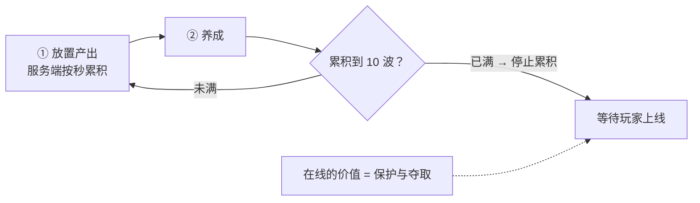

# 流程图 / 框架图 + 多文档整合 HTML

## When to Use

- 用户说「这些流程图能不能画出来」「加个架构图 / 循环图 / 依赖图」，或给出 ASCII 图要求改成真正的图。
- 用户给了 2 份以上 md，要求「整合在一起，用 HTML 展示」。
- 交付物是**文档里的图**（策划案 / 方案 / 研究笔记），不是插图美术（那走 image_generate）。

**默认路线：Mermaid。** 理由：Obsidian 原生渲染、可 diff、和文档同源、改口径时图跟着改。
升级路线：Obsidian 已装 **Excalidraw 插件** → 选中 mermaid 块可用命令 *Convert Mermaid to Excalidraw* 转成可拖拽手绘图。**先 mermaid，别一上来做手绘。**
Figma：**无插件/无 skill**，需 API token 且产图不在 vault 里 → 对本项目是纯增依赖，**不建议**。

## 决策顺序

1. 图要跟着文档迭代 → **mermaid 写进 md**（默认）。
2. 图要手绘风 / 要拖拽精修 → mermaid 落 md 后，用户自己在 Excalidraw 里一键转（**不要**手搓 .excalidraw JSON，除非用户明确要）。
3. 图只是给人看的展示件、不要求进 md → 直接塞进 HTML（见下）。

## Workflow

```
① 定位「哪些地方值得成图」→ ② 写 mermaid → ③ 落进 md → ④（可选）整合 HTML → ⑤ 自检 → ⑥ 交付说明
```

### ① 定位图点

优先这五类，其余用列表/表格更省事：

- **循环结构**（玩法循环、产消循环、节拍流程）
- **分层 / 依赖**（系统框架 L0→L4、模块依赖）
- **决策分叉**（守住 / 失守、胜负分支）
- **流程链**（挑战 → 结算 → 抓取 → 进驻）
- **结构公式**（基座 × 连乘乘区这种可视觉化的算式）

一张图一个主题。**超过 ~15 个节点就拆**，否则必然挤成一团。已有图能复用就复用（例：`系统框架拆分.md §3.1` 的分层依赖图直接 import 进 HTML，不重画）。

### ② 写 mermaid（规范）



- **带空格 / 标点 / 中文的节点标签一律加双引号** `A["文本"]`；括号、`·`、`—`、`+` 不加引号会解析失败。
- 换行用 `<br/>`（不是 `\n`）。
- 决策节点 `{"问题"}`，虚线 `-.->`，边标签 `-->|"文字"|`。
- **方向决定宽高**：`LR` 链一长就 2000px+ 宽（要横向滚动）；节点多、链条长时改 `TB`，宽度会掉到 ~1100px，正好塞进正文栏。**先写 LR，量到超宽再换 TB**。
- 预算宽度参考：正文栏 ≈1240px（HTML）/ Obsidian 自适应。目标 <1200px。
- 子图 `subgraph 名["标题"] ... end` 用来分组（乘区、消耗口、层级）。

### ③ 落进 md

- 图放在它论证的那一节，**紧跟在相关列表之后**，前面一行加标题：
  `**图 A｜收益结构（基座 × 连乘乘区）**`
- 原 ASCII 图**直接替换**（别两张都留）。
- 文档有版本表 → 加一行 `v1.x｜图形化：补 mermaid 图 X/Y/Z`，写明图的编号与所在小节。

### ④ 整合 HTML（多份 md → 单页）

已有可复用管线（不要再从零写）：

```bash
python3 ~/.hermes/profiles/obsidianbackup/scripts/build_mine_html.py
```

- 脚本：`~/.hermes/profiles/obsidianbackup/scripts/build_mine_html.py`（改数据源路径 + 部件装配清单）
- 模板：同目录 `mine_template.html`（CSS + 侧栏 TOC + mermaid 渲染脚本，占位符 `__NAV__` / `__BODY__` / `__MERMAID_JS__` / `/*__MERMAID_CSS__*/`）
- mermaid 整包：`~/.hermes/profiles/obsidianbackup/vendor/mermaid.min.js`（无则 `curl -sL -o 该路径 https://cdn.jsdelivr.net/npm/mermaid@11/dist/mermaid.min.js`）
- 关键实现点：
  - `markdown.markdown(md, extensions=['tables','fenced_code','sane_lists'])` → 依赖 `pip3 install --user markdown`
  - **fenced mermaid 块必须转成 div 才能渲染**：
    ```python
    def mermaid_div(m):
        code = htmllib.unescape(m.group(1)).strip('\n')
        return '<div class="mermaid">' + htmllib.escape(code) + '</div>'
    html, n = re.subn(r'<pre><code class="language-mermaid">(.*?)</code></pre>', mermaid_div, html, flags=re.S)
    ```
  - 前端：`mermaid.initialize({startOnLoad:false, securityLevel:'loose', theme: dark?'dark':'default', flowchart:{useMaxWidth:false, htmlLabels:true, curve:'basis'}})` 再 `mermaid.run({querySelector:'.mermaid'})`
  - **`useMaxWidth:false`**：让图按原始尺寸渲染 + 容器 `overflow-x:auto`。用 `true` 会把 2200px 的宽图压成 10px 小字，更糟。
  - 内联 mermaid.min.js 前先 `grep -c '</script' mermaid.min.js`（应为 0），否则要转义。

### ⑤ 自检（必做，别凭感觉）

```bash
C="/Applications/Google Chrome.app/Contents/MacOS/Google Chrome"
"$C" --headless=new --disable-gpu --hide-scrollbars --window-size=1440,2600 \
  --virtual-time-budget=9000 --screenshot=/tmp/out.png "file://<绝对路径>/x.html"
```

再 DOM 校验（最可靠，能一次看清每张图成败与尺寸）：

```python
dom = subprocess.run([CHROME,'--headless=new','--disable-gpu','--virtual-time-budget=10000',
                      '--dump-dom','file:///tmp/mm_probe.html'], capture_output=True, text=True).stdout
print(dom.count('data-processed="true"'), dom.count('<svg'))
for m in re.finditer(r'<svg[^>]*viewBox="([^"]+)"[^>]*>', dom): print(m.group(1))
```

- `data-processed="true"` 数量 == mermaid 块数量 → 全部渲染成功。
- viewBox 宽 > 1300 → 换成 `flowchart TB` 或合并节点重排。
- 看 `</script`、`__NAV__` 等占位残留要清零。
- 交付前再 `vision_analyze` 看一眼截图，确认文字没被压小、没遮挡。

### ⑥ 交付说明

给：文件路径 + 结构 + **验证过的具体尺寸/数量** + 已知取舍（宽图要横向滚动、文件多大）+ git 状态（未 commit）。别只说「已生成」。

## Pitfalls

- ❌ 一张图塞 25 个节点 → 挤成一坨。拆图或合并同类节点（把 6 个消耗口合并成一个多行节点，宽度立刻从 2200 → 1084）。
- ❌ 标签不加引号 → mermaid 静默渲染失败（页面里显示原始代码或红色错误框）。
- ❌ 用 `useMaxWidth:true` 修宽度 → 图变小字。
- ❌ 只截图不查 DOM → 某张图渲染失败但你只看了顶部。
- ❌ 整合时把源文档的 `##` 标题也降级 → 部件标题（`##`）和正文标题（`###`）**降级规则不同**：只降正文，别降部件标题。
- ❌ 交付前不检查 `<h2 id=...>` 数量 → 侧栏 TOC 空（曾经踩过：正文全被降成 h3，nav 为空）。
- ❌ 手搓 .excalidraw JSON 当默认方案 → 除非用户点名，先 mermaid。
- ❌ 改完 md 忘了重跑构建脚本 → HTML 还是旧的。

## Reference

实战产出（本 skill 的验收标准样例）：

- `我家里有矿/我家里有矿｜策划案与玩法循环（整合）.html` —— 6 张 mermaid（收益结构 / 四环循环 / 分层依赖 / 资源产消 / 排位节拍 / 家园防守）+ 侧栏 TOC + 深色模式 + 打印分页，3.5MB 离线单文件。
- 源文件：`我家里有矿｜策划案.md`（图 A/B/C）、`我家里有矿｜玩法循环.md`（图 1/2，原 ASCII 已替换）。
- 图 3 复用 `我家里有矿｜系统框架拆分.md §3.1` 的 mermaid 块（import，不重画）。
